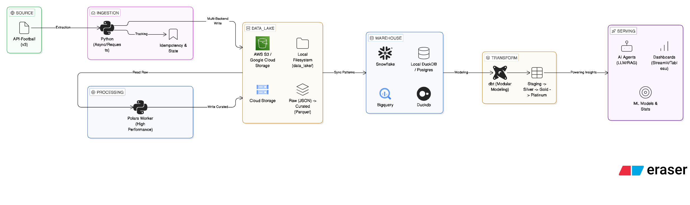

# Football-Stack


⭐ If you find this project useful, consider starring the repository!

**Football-Stack** It is an end-to-end data engineering pipeline that automates the ingestion, storage, and transformation of football (soccer) league data via [API-Football](https://www.api-football.com/). 


💡 **Cost-Efficient & High Performance:** We built this architecture with a relentless focus on minimizing operational costs while maximizing performance. By utilizing intelligent idempotency (to eliminate redundant and costly API calls), local-first development options, and optimized data processing, we drastically lowered the cost of running a large-scale sports data pipeline.

It is designed to be fully extensible, supporting any league globally without hardcoded defaults, and orchestrates data from raw API payloads all the way to agent-ready AI features.

<div align="center">
  
</div>

## Why Football-Stack?

Most football data projects stop at raw API ingestion.

Football-Stack provides a complete analytics data platform:

• Automated ingestion pipelines  
• Scalable warehouse modeling  
• Clean analytics datasets  
• AI-ready features for agents and ML systems  

Instead of spending weeks building data infrastructure, you can start analyzing football data immediately.

## Data Architecture 

### Architecture overview:
API-Football → Python ingestion → Data Lake (Local/S3/GCS) → Snowflake → dbt models → Analytics & AI features

- **Staging & Silver Layers (Objective Prep):** These layers strictly focus on cleaning, normalizing, deduplicating, and standardizing the raw JSON data. They are universal and provide a solid, trusted foundation perfectly mirroring the API.
- **Gold & Platinum Layers (Subjective & Use-case Driven):** These layers construct business logic and AI-ready features. Metrics like "Team Form," "Attacking Style," or "Player Impact" are highly subjective and depend heavily on your product's specific needs. We have provided **rich, pre-built Gold and Platinum models** as powerful starting points, but you have the flexibility to customize or replace these logic layers to fit your exact goals.

## Tech Stack

### Core
<p align="left">
  
  
  
</p>

### Storage
<p align="left">
  
  
  
</p>

### Source & Execution
<p align="left">
  
  
</p>

## Use Cases

Football-Stack can power multiple types of football data products:

- 📊 Football analytics dashboards
- 🤖 AI coaching agents
- 📈 Machine learning models for match prediction
- 🧠 Tactical analysis and opponent scouting tools
- 🧪 Data science experimentation on sports data
- 🎮 Fantasy football platforms (player performance scoring, lineup optimization, and match insights)

## Features

### Ingestion (Bronze Layer)
- **Coverage**: Full league baseline (fixtures, teams, standings, rounds) and deep details (statistics, events, lineups, players, predictions, injuries, transfers).
- **Multi-Provider Storage**: Pluggable storage backends — **local filesystem** (default, zero cloud deps), **AWS S3**, or **Google Cloud Storage**. Controlled via `STORAGE_BACKEND` env var or config file.
- **Idempotency**: All ingestion steps use marker files to prevent duplicate API calls and ensure safe re-runs.
- **Resilience**: API client includes exponential backoff retry logic and rate limiting.
- **Paginated Ingestion**: Optimized handling for large datasets like league-wide player lists.

### Transformation (Silver Layer)
- **dbt Integration**: Modern transformation workflow with version-controlled SQL.
- **Schema Contracts**: explicit casts and column documentation for all staging models.
- **Data Quality**: Automated dbt tests for `not_null`, `unique`, and `accepted_values`.
- **Deduplication**: Intelligent handling of raw partition overlaps to ensure a consistent Silver state.

### Transformation (Platinum Layer - AI Features)
- **Agent-Ready Marts**: 12 highly enriched models optimized specifically for LLM-based coaching agents.
- **Player Archetypes**: Standardized 0-100 scores across 6 distinct profiles via `platinum_player_style_fingerprint`.
- **Match Narratives**: Halftime swing, goal margins, and expected goals dominance via `platinum_match_intelligence`.
- **Prediction Scoring**: Accurate confidence tracking and upset detection via `platinum_prediction_accuracy`.

## Environment Setup

1. **Python Environment**: Initialize a virtual environment and install dependencies.
   ```bash
   python -m venv .venv
   source .venv/bin/activate
   pip install -r requirements.txt
   ```

2. **Configuration**: Copy the example environment file and fill in your credentials.
   ```bash
   cp .env.example .env
   ```
   At minimum you need `API_FOOTBALL_KEY`, `LEAGUE_ID`, and `SEASON`. Storage defaults to local filesystem (`data_lake/` directory) — no cloud credentials required to get started.

3. **Multi-League Config** (optional): For multi-league, multi-season runs, copy and edit the JSON config:
   ```bash
   cp pipeline_config.json.example pipeline_config.json
   ```

### Storage Backends

| Backend | `STORAGE_BACKEND` | Required vars | Extra dependency |
|---|---|---|---|
| Local filesystem (default) | `local` | `LOCAL_ROOT` (default `data_lake`) | None |
| AWS S3 | `s3` | `S3_BUCKET`, `AWS_REGION`, AWS credentials | `boto3` |
| Google Cloud Storage | `gcs` | `GCS_BUCKET`, optionally `GCS_PROJECT` | `google-cloud-storage` |

Backward compat: if `STORAGE_BACKEND` is unset but `S3_BUCKET` is set, the backend is inferred as `s3`.

## Quick Start

### 🐳 Docker (The Easiest Way)

You can run the entire pipeline with a single command using Docker. Ensure Docker and Docker Compose are installed.

1. Ensure your `.env` file is ready with the required API keys.
2. Run the end-to-end pipeline:
   ```bash
   docker-compose up
   ```
   This will automatically build the image, install Python and dbt dependencies, and execute the full pipeline. The ingested data will be stored safely in your local `data_lake/` folder via volume mapping.

### Python Ingestion
To run the daily ingestion script:

```bash
python -m scripts.run_daily
```

By default, this will run for the current date. You can also specify a specific date:

```bash
python -m scripts.run_daily --date 2026-02-15
```

Run a specific league id (single-league run):

```bash
python -m scripts.run_daily --league-id 39
python -m scripts.run_daily --league-id 307
```

### End-to-End Automated Pipeline (Recommended)
Run ingestion + Snowflake RAW sync (`COPY INTO`) + dbt build in one command:

```bash
python -m scripts.run_pipeline
```

Optional date override:

```bash
python -m scripts.run_pipeline --date 2026-02-15
```

Run a specific league id (single-league run):

```bash
python -m scripts.run_pipeline --league-id 39
python -m scripts.run_pipeline --league-id 307
```

Multi-league run from a JSON config file:

```bash
python -m scripts.run_pipeline --config pipeline_config.json
```

**Ingestion-only mode** (local storage users, skip Snowflake/dbt):

```bash
python -m scripts.run_pipeline --skip-raw-sync --skip-dbt-build
```

If you need to resync pending RAW files across all dates (no `dt` filter):

```bash
python -m scripts.run_pipeline --skip-ingestion --raw-sync-all-dates
```

If late-night fixtures finished after your first run on the same date, force-refresh league snapshots:

```bash
python -m scripts.run_pipeline --force-league-snapshot-refresh
```

For a low-cost same-day refresh (baseline endpoints only):

```bash
python -m scripts.run_pipeline --force-league-snapshot-refresh --baseline-only
```

What the full pipeline does:
- Runs API-Football ingestion to the configured storage backend.
- Runs dbt macro `sync_raw_from_s3` to load S3 files into `LEAGUES_DATA.RAW.*` (S3 backend only).
- Runs `dbt build --select staging silver gold platinum` (models + tests). **Note:** Gold and Platinum models are disabled by default.

To enable the advanced analytical layers (Gold) and AI features (Platinum), use the respective flags. (**Note:** Enabling Platinum automatically enables the Gold layer it depends on):
```bash
python -m scripts.run_pipeline --enable-gold --enable-platinum
```

Season selection note:
- `SEASON` is always read from `.env` (`SEASON=...`), including when `--league-id` is used.

### Airflow Orchestration (Optional)

For production scheduling with a web UI, retry logic, and parallel league processing, the project includes an Apache Airflow setup. All Airflow services run behind a Docker Compose `airflow` profile, so they never interfere with the existing CLI workflow.

**Start the Airflow stack:**

```bash
# 1. Initialize the database and create an admin user
docker compose --profile airflow up postgres airflow-init

# 2. Start the webserver and scheduler
docker compose --profile airflow up airflow-webserver airflow-scheduler
```

Open **http://localhost:8080** and log in with `admin` / `admin` (or the password set in `AIRFLOW_ADMIN_PASSWORD`).

**Available DAGs:**

| DAG | Schedule | Description |
|-----|----------|-------------|
| `football_pipeline` | Manual trigger | Full pipeline: ingest → flatten → dbt build. Dynamically maps tasks over all league/season targets in `pipeline_config.json` for parallel execution. |
| `football_daily_ingest` | `@daily` | Lightweight single-league daily ingestion (mirrors `run_daily.py`). |

Trigger `football_pipeline` from the UI with custom params like `{"dev_limit": 2}` for a quick test run.

**Airflow environment variables** (add to `.env`):

| Variable | Purpose |
|----------|---------|
| `AIRFLOW__CORE__FERNET_KEY` | Encryption key for Airflow connections/variables |
| `AIRFLOW_ADMIN_PASSWORD` | Password for the Airflow admin user (default: `admin`) |

> **Note:** The existing CLI scripts (`run_pipeline.py`, `run_daily.py`) and the base Docker image remain fully functional — Airflow is purely additive.

If you prefer a simpler cron-based schedule instead of Airflow:

```bash
15 3 * * * cd /path/to/Leagues_Data_Project && /bin/zsh -lc 'source .venv/bin/activate && python -m scripts.run_pipeline >> logs/pipeline.log 2>&1'
```

### dbt Transformations
The dbt project is located in `leagues_data_dbt`.

Note: The orchestration script expects `dbt` CLI to be installed and available on `PATH`.

```bash
cd leagues_data_dbt
dbt deps      # Install dependencies
dbt build     # Run models and tests
```

Targeted builds used for current staging rollout:
```bash
dbt build -s stg_teams stg_player_leaderboards
dbt build -s stg_match_team_stats stg_lineup_players
dbt build -s stg_fixtures stg_rounds stg_match_events
dbt build -s stg_match_player_stats stg_predictions
dbt build -s stg_team_standings stg_team_statistics stg_player_season_stats stg_squad_players stg_transfers stg_injuries
dbt build -s staging
dbt build -s silver
dbt run -s gold --full-refresh
```

To view documentation:
```bash
dbt docs generate
dbt docs serve
```

## Project Structure
- `src/pipeline/`: Core ingestion logic (API client, storage, orchestration).
- `leagues_data_dbt/`: dbt project for SQL transformations.
- `airflow/dags/`: Airflow DAG definitions for pipeline orchestration.
- `scripts/`: Operational scripts and entry points.
- `docs/`: Strategic architecture and implementation tracking.
- `tests/`: Unit and integration tests for the Python pipeline.

## Primary Documents
Architecture plan:
- `docs/Data Engineering Architecture and Plan.md`
Implementation checklist:
- `docs/Data Engineering Implementation Checklist.md`
Project Context:
- `docs/Project_Context.md`

## Contributing

Contributions are what make the open source community such an amazing place to learn, inspire, and create. Any contributions you make are **greatly appreciated**.

Please refer to the [CONTRIBUTING.md](CONTRIBUTING.md) for detailed guidelines on how to set up the project and submit your pull requests.

## License

Distributed under the MIT License. See [LICENSE](LICENSE) for more information.
