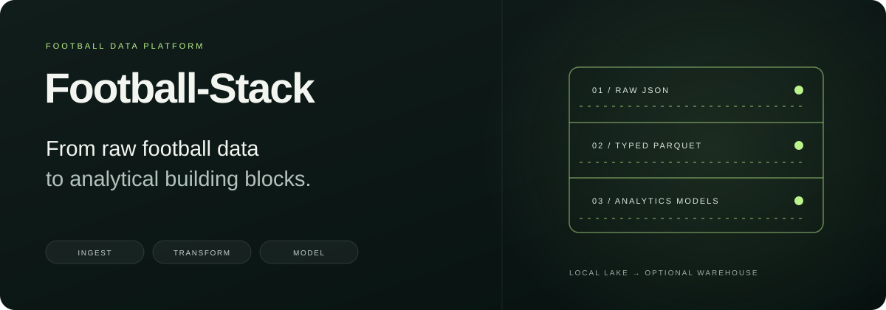
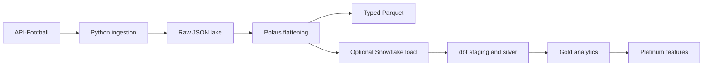

<p align="center"></p>
<p align="center">
  <a href="https://github.com/KhalidD0nc/Football-Stack/actions/workflows/ci.yml"></a>
  
  
  
  <a href="LICENSE"></a>
</p>
<p align="center"><strong>A football analytics pipeline, from API payloads to reusable data models.</strong></p>
<p align="center">
  <a href="#architecture">Architecture</a> · <a href="#quick-start">Quick start</a> ·
  <a href="docs/OPERATIONS.md">Operations</a> · <a href="leagues_data_dbt/README.md">dbt models</a> ·
  <a href="CONTRIBUTING.md">Contributing</a> ·
  <a href="https://www.kaggle.com/datasets/khalidald/football-stack">Dataset ↗</a>
</p>

Football-Stack ingests league and match data from API-Football, stores the original responses, and flattens them into typed Parquet tables. An optional Snowflake load feeds dbt models for team performance, player analysis, match intelligence, and prediction evaluation.

Start with local files and one league. Add object storage, warehouse transformations, and Airflow orchestration as your workflow needs them.

## What is inside

| Component | Implemented capabilities |
| --- | --- |
| Ingestion | Fixtures, teams, standings, rounds, players, lineups, events, statistics, predictions, injuries, and transfers |
| Request handling | Retries, rate limiting, pagination, and marker-based checks before repeated fetches |
| Storage | Local filesystem, Amazon S3, or Google Cloud Storage through a common writer interface |
| Flattening | Polars transformations, explicit Arrow schemas, source/entity deduplication, and Parquet output |
| Warehouse | Optional direct loading of curated tables into Snowflake |
| Analytics | dbt staging, silver, gold, and platinum layers |
| Scheduling | Optional Airflow DAGs for daily ingestion and the full pipeline |

## Architecture



The lake can live on disk, S3, or GCS. The active direct warehouse adapter is **Snowflake**; GCS storage support does not imply an implemented BigQuery loading path. The default dbt path reads curated tables loaded by Python. See [architecture and data contracts](docs/ARCHITECTURE.md).

## Quick start

### 1. Install

Use **Python 3.11 or newer**; CI uses Python 3.12.

```bash
git clone https://github.com/KhalidD0nc/Football-Stack.git
cd Football-Stack
python3.12 -m venv .venv
source .venv/bin/activate
python -m pip install -r requirements.txt
cp .env.example .env
```

On Windows, activate with `.venv\Scripts\Activate.ps1`. The example configuration starts with local storage and direct warehouse loading disabled.

### 2. Configure one league

Set these values in `.env`:

```dotenv
API_FOOTBALL_KEY=your-api-football-key
LEAGUE_ID=39
SEASON=2025
STORAGE_BACKEND=local
LOCAL_ROOT=data_lake
DATA_WAREHOUSE=none
```

Use a league and season included in your API-Football access. Real ingestion consumes that provider's request quota. No cloud account is needed for the local-file path.

### 3. Ingest and flatten

```bash
# Raw JSON plus curated Parquet; skips warehouse transformations
python -m scripts.run_pipeline --skip-dbt-build

# Raw ingestion only
python -m scripts.run_daily --league-id 39

# Limit ingestion for an exploratory run
python -m scripts.run_pipeline --dev-limit 2 --skip-dbt-build
```

`--dev-limit` also selects test bucket/database settings when configured. With `DATA_WAREHOUSE=none`, direct warehouse loads stay disabled. The generated lake contains `raw/`, `curated/`, and fetch markers. Keep it outside version control.

## Add Snowflake and dbt

```bash
python -m pip install 'dbt-snowflake>=1.9,<2'
cp leagues_data_dbt/profiles.yml.example leagues_data_dbt/profiles.yml
```

Configure your warehouse connection in `.env`, set `DATA_WAREHOUSE=snowflake`, and fill the profile's environment variables. The Python loader uses `WAREHOUSE_URI`; dbt uses its separate profile. They must point to the intended account and database.

```bash
# After configuring and verifying the intended warehouse
python -m scripts.run_pipeline

# Opt in to analytical and AI-oriented layers
python -m scripts.run_pipeline --enable-gold --enable-platinum
```

Gold and platinum are disabled by default; enabling platinum also enables gold in the orchestration script. These layers contain configurable analytical definitions, not independently validated performance or prediction claims. See the [dbt guide](leagues_data_dbt/README.md) for profiles, model layers, and checks.

## Multiple leagues and operations

```bash
cp pipeline_config.json.example pipeline_config.json
python -m scripts.run_pipeline --config pipeline_config.json --skip-dbt-build

# Multiple leagues for the SEASON configured in .env
python -m scripts.run_pipeline --league-ids 39 307 --skip-dbt-build
```

[Operations](docs/OPERATIONS.md) covers storage configuration, snapshots, limited runs, Docker, and Airflow. In particular, `--dry-run` only suppresses the dbt subprocess; it does **not** disable ingestion or flattening.

## Development checks

```bash
python -m pip install -r requirements-dev.txt
python -m pytest tests/ -q

# Parse all dbt layers offline using the placeholder CI profile
dbt parse --project-dir leagues_data_dbt --profiles-dir .github/dbt \
  --no-partial-parse --vars '{"enable_gold_layer": true, "enable_platinum_layer": true}'
```

The unit suite exercises configuration, ingestion behavior, transformations, schema conformance, Parquet round-trips, and orchestration. CI also parses the dbt graph without warehouse credentials. These checks do not run live API ingestion, execute warehouse SQL, or start Airflow.

## Repository map

```text
src/pipeline/          # API client, config, ingestion, storage, schemas, flattening
scripts/               # Pipeline entry points and operational helpers
leagues_data_dbt/       # SQL models, source declarations, and data tests
airflow/dags/          # Optional orchestration
tests/                 # Offline unit tests and sample payloads
docs/                  # Architecture and operations guides
resources/             # Existing pipeline illustration
```

## Branch workflow

```text
feature/* → development → staging → main
```

`development` integrates reviewed changes, `staging` holds release candidates, and `main` is the stable reference. CI runs on all three. Git branches do not provision separate lakes, warehouses, or schedules; configure environment-specific resources explicitly.

Read [CONTRIBUTING.md](CONTRIBUTING.md) for contribution boundaries and promotion steps. Distributed under the [MIT License](LICENSE).
